### Hello

I'm an **AI & Automation Engineer at Scoreme Solutions Private Limited**. I work on **Atlas**, the agentic credit-intelligence platform behind [resurgentindia.ai](https://resurgentindia.ai) — turning a single company ID into bank-ready credit workbooks, board notes, forensic audits, valuations and AML reports.

I care about AI that is **fast, verifiable and actually trusted with real decisions**: every figure a report generates should trace back to its source document.

---

## 01 — What I do

<table>
<tr>
<td width="33%" valign="top">

### Agentic AI
Multi-step LLM agents that research, reason and write, with **verification built in**: second-opinion reviewers, fact-checks and source citations on every answer.

</td>
<td width="33%" valign="top">

### Automation at scale
Pipelines that replace manual work end to end: document OCR, data normalization, self-healing jobs and one-click report generation.

</td>
<td width="33%" valign="top">

### Production engineering
APIs, data platforms and full-stack apps that **stay up**: Flask/React services, job queues, Google Drive caching and monitoring.

</td>
</tr>
</table>

---

## 02 — Flagship system

**[Atlas](https://github.com/shaleen2004/atlas-agentic-credit-intelligence) is the AI credit-intelligence platform behind [resurgentindia.ai](https://resurgentindia.ai).**
- From a single company ID it produces **bank-ready deliverables**: credit workbooks, board notes in 24 bank formats, forensic audits, valuations and AML reports.
- Cuts work that took analysts **weeks down to minutes**, and every figure traces back to its source document.
- A **live SaaS** used across the company and by client teams, with a web app, a **native iOS app** and a partner API.

 

**TEV Studio is Atlas's Techno-Economic Viability report workflow** — a 5-chapter TEV generator (technical feasibility, industry & marketing feasibility, financial viability, SWOT/risk and critical success factors) with its own chat assistant on top.
- Generates chapters individually or as a full report, each grounded in the company's uploaded financial model and documents.
- A dedicated chatbot lets an analyst ask "section 8.2 needs more detail" and have **only that section** edited in place — no full chapter regeneration or re-billing.
- "Convert to Word" reproduces the **original template's exact styling**, not a generic markdown export.
- Validates a client's draft financial model against the final one and flags discrepancies automatically.
- Tracked with a **real per-call Gemini + Claude cost ledger**, and extended with a Debt Syndication prototype (document upload, MCA pull, checklist, chat).

---

## 03 — Technical toolbox

  

---

## 04 — How I build

| Principle | In practice |
|:--|:--|
| **AI must be checkable** | Every AI answer links back to the document or record it came from. |
| **Never invent a number** | Real figures come from real sources. Gaps stay visibly empty, never guessed. |
| **Automate the boring, guard the critical** | Machines do the repetitive work; tests, audits and alerts protect what matters. |
| **Ship, then measure** | Production usage, uptime and accuracy decide what gets built next. |

---

### Let's build something that matters

I enjoy hard problems where **correctness matters**: finance, compliance and data at scale. 
**[Drop me an email](mailto:shaleen1312@gmail.com)** if that sounds like your team.

